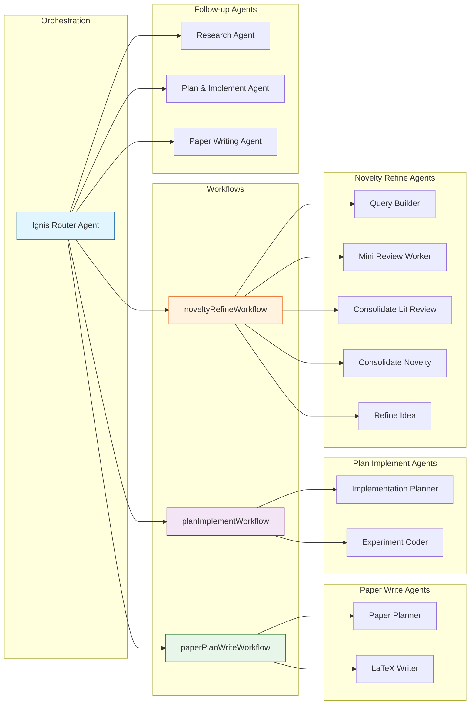
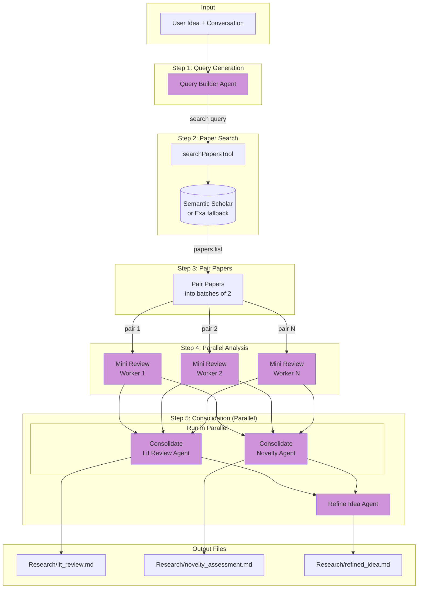
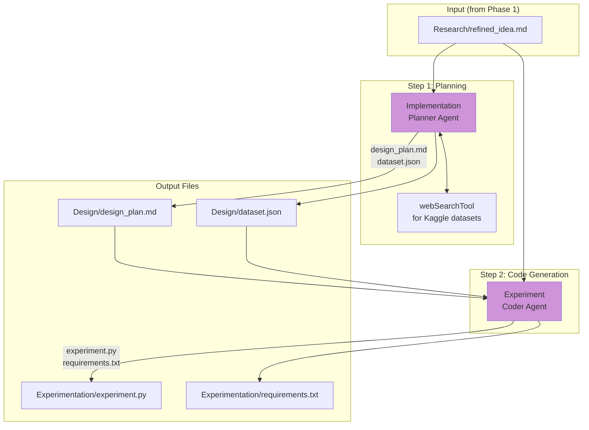
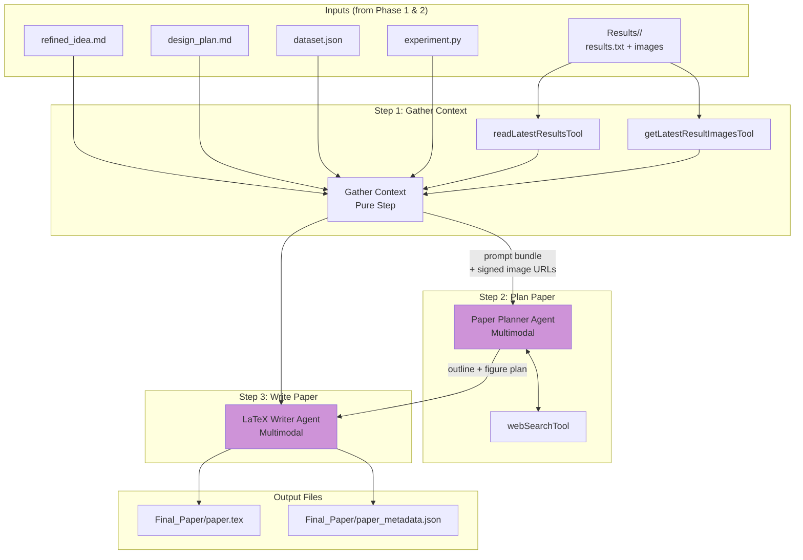

# Ignis Agent Architecture Flowchart

## Main Architecture Overview

---

## Novelty Refine Workflow (Phase 1)

---

## Plan & Implement Workflow (Phase 2)

---

## Paper Plan & Write Workflow (Phase 3)

---

## Evaluation Framework

### 1. Literature Review & Novelty Assessment

> **Objective:** Validate the quality and originality of research synthesis produced by the Novelty Refine Workflow.

| Metric | Description | Benchmark Reference |
|--------|-------------|---------------------|
| **ResearcherBench Comparison** | Evaluate against 65 frontier AI research questions spanning literature review tasks | [ResearcherBench](https://arxiv.org/abs/2507.16280) |
| **Citation Recency** | Measure % of citations from last 3 years | [Sakana AI Scientist Eval](https://arxiv.org/abs/2502.14297) |
| **Citation Relevance** | Semantic similarity between cited papers and research topic | [IdeaBench](https://arxiv.org/html/2411.02429v1) |
| **False Novelty Detection** | Check for misclassification of established concepts as novel | [Hidden Pitfalls Paper](https://arxiv.org/pdf/2509.08713) |

**Key Outputs Evaluated:**
- `Research/lit_review.md`
- `Research/novelty_assessment.md`
- `Research/refined_idea.md`

---

### 2. Code Generation (experiment.py)

> **Objective:** Measure the reliability and correctness of generated experiment code executed on Modal.

| Metric | Description | 
|--------|-------------|
| **Execution Success Rate** | % of experiments that run without errors on Modal | 
| **Result Reproducibility** | Same code produces identical results across multiple runs |
| **Resource Efficiency** | GPU utilization and runtime within expected bounds |

**Key Outputs Evaluated:**
- `Experimentation/experiment.py`
- `Experimentation/requirements.txt`
- `Results/<timestamp>/results.txt`

---

### 3. Paper Generation

> **Objective:** Assess the quality, accuracy, and academic rigor of generated LaTeX papers.

| Metric | Description | Methodology |
|--------|-------------|-------------|
| **LLM Reviewer Score** | Simulated peer review using GPT-4o | [Sakana methodology](https://sakana.ai/ai-scientist-first-publication/): 5 rounds self-reflection + ensemble reviews |
| **Factual Consistency** | Claims in paper match actual experimental results | Cross-reference `results.txt` with paper assertions |
| **Citation Quality** | Relevance, recency, and proper attribution | Target: >10 citations median, >50% from last 5 years |
| **Structural Completeness** | No missing figures, placeholders, or repeated sections | Automated LaTeX validation |

**Key Outputs Evaluated:**
- `Final_Paper/paper.tex`
- `Final_Paper/paper_metadata.json`

---

### Cost Estimate

> **Each end-to-end evaluation test costs approximately $15 in cloud credits.**

- LLM API calls (Vertex AI / Gemini) across all three workflow phases
- Modal GPU compute for experiment execution

---

### Real-World Validation

> **We have a waitlist of 150+ users.**

Our eventual goal is to have actual users validate Ignis by using it to automate their research workflows. 